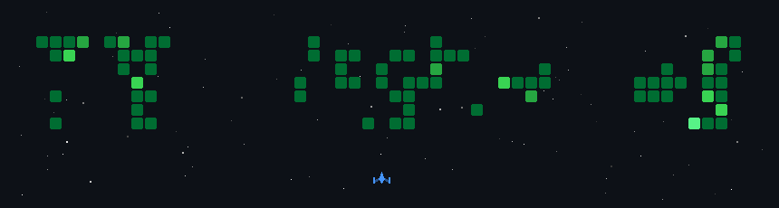

<!-- ═══════════════════════════ HEADER ═══════════════════════════ -->

  

  

  
  
  

---

### 👨‍💻 Sobre mí

- 🎓 Estudiante de la **Escuela Politécnica Nacional (EPN)**
- 🔭 Trabajando en proyectos personales y académicos
- 🌱 Aprendiendo constantemente nuevas tecnologías
- 📫 Contacto: **carlos.puente@epn.edu.ec**

---

### 🛠️ Stack tecnológico

  

---

### 📊 Estadísticas de GitHub

  
  

  

  

---

### 🚀 Contribuciones en acción

  

---

  <a href="https://github.com/mangodev-hub?tab=repositories"><b>Ver todos los repositorios</b></a>
  &nbsp;·&nbsp;
  <a href="mailto:carlos.puente@epn.edu.ec">Contactar por correo institucional</a>

  

